<p align="center">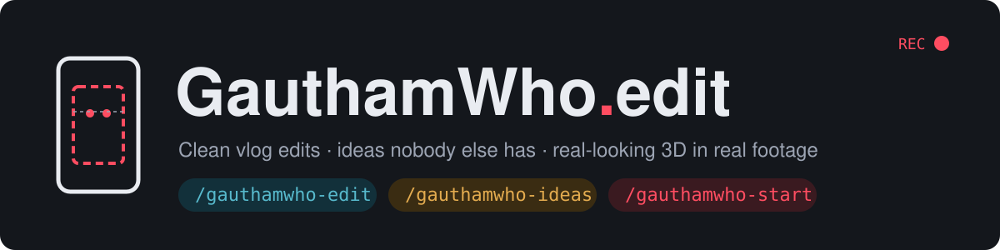</p>

# GauthamWho edit

A set of **Claude Code skills** that edit my own phone vlogs (Instagram **@GauthamWho**, Tamil
day-in-the-life reels shot on an iPhone) **exactly the way I like them**. They also come up
with ideas nobody else would think of, and put **real-looking 3D objects and characters** into
my real footage.

You drop a video in a folder, type one command, answer a few questions, and get back a
finished reel. Every rule in here came from me approving or rejecting real edits of Reel 29.

---

## The three commands

| Type in Claude Code | What it does | You get |
|---|---|---|
| `/gauthamwho-edit D:\Claude\Video\Reel 30` | **Clean edit.** Cuts the dead air while I talk, adds a few face punch-ins, and keeps my iPhone colour. | 2 video files: one to post (SDR) and one HDR |
| `/gauthamwho-ideas D:\Claude\Video\Reel 30` | **Ideas only.** Studies the clip and invents graphic moments. **Nothing is built.** | A list of opportunities, the top 3 ideas sketched on my real frames, and more ideas in one line each |
| `/gauthamwho-start D:\Claude\Video\Reel 30` | **Edit + ideas together**, in one message. | The edit questions and an idea menu. The edit gets built, then the ideas I pick get made |
| `/gauthamwho-edit D:\Claude\Video\Reel 30 at 0:36 a ghost rises behind my left shoulder…` | **My own graphic from my script.** | That graphic, step by step: beat sheet → storyboard → still → preview → full video |

> Slash commands can't contain spaces, so the names use dashes.
> When I say "left" or "right", I always mean **my own body's** left and right.

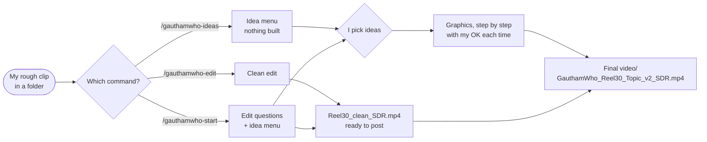

---

## 1. `/gauthamwho-edit`: the clean edit

### What it does to the video

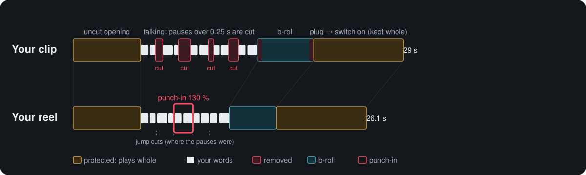

- **My order stays exactly as I edited it.** Nothing is reordered, and there are no hooks.
- **Pauses longer than 0.25 s while I talk are cut**, and stammers and repeated takes are
  removed. It never cuts inside a word: it knows the time of every Tamil word.
- **My little sequences stay whole:** plug in → switch on; show the bag → drop it → black clip →
  walk in.
- **The opening plays uncut.**
- **One 130 % face punch-in per talking scene**, on its strongest line, with my eyes always on
  the same line.
- **No music, transitions, captions or effects.** I add captions myself later.

### The punch-in (the only effect)

<p align="center">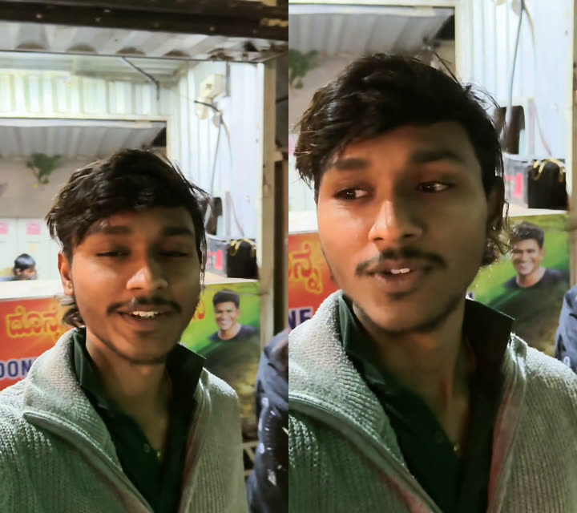</p>

*Left: normal framing. Right: a hard cut to 130 %, with my eyes on the upper-third line. It holds
until the next jump cut, so the cut back hides inside a cut that's already there.*

### What happens, step by step

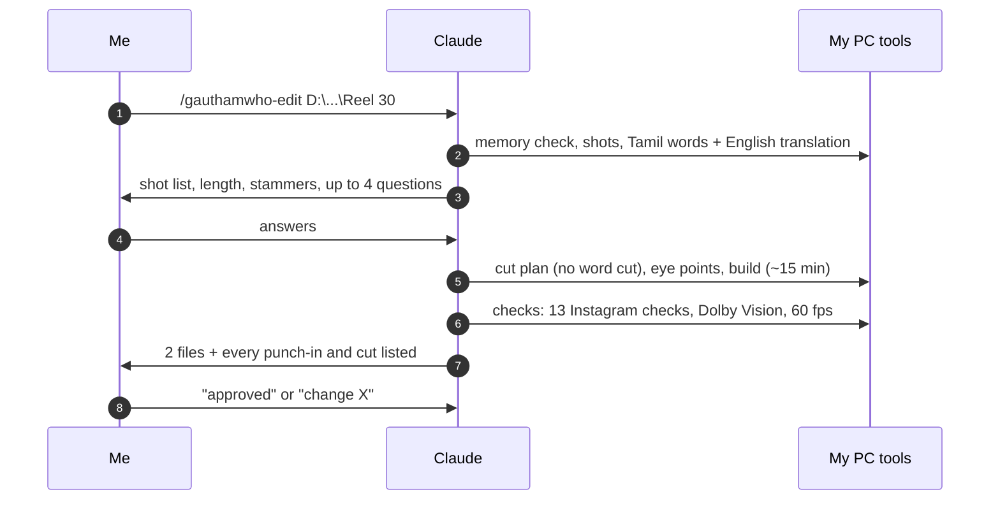

**The 4 questions it asks** (each with my usual answer pre-selected):
1. Where does the uncut opening end?
2. Which moments must play completely uncut?
3. Which lines get a punch-in?
4. What to do with silent shots?

### Why the colour stays like my iPhone

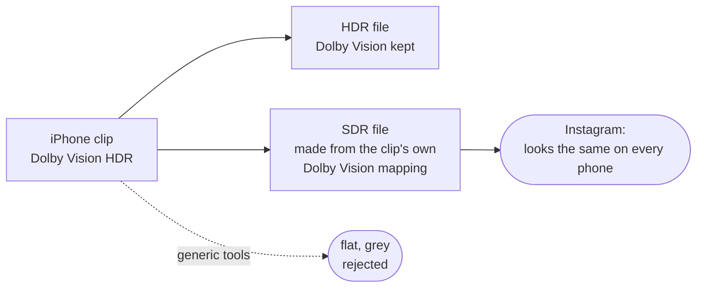

---

## 2. `/gauthamwho-ideas`: the creative engine

This is the part that thinks of moments **nobody else would**. The ghost was one of them: a
scare for people scrolling alone at midnight, unrelated to the script, and the kind of thing
they remember.

**How it thinks:**

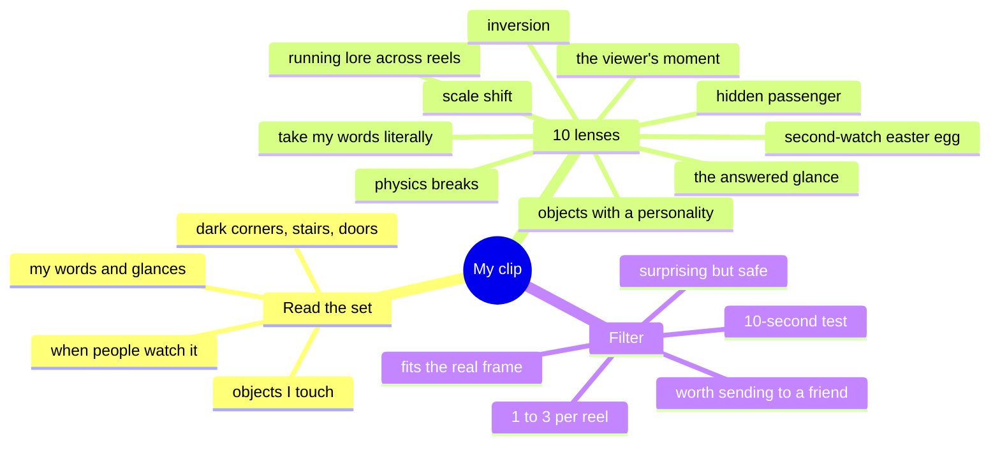

- **The 10-second test:** if three other creators would think of an idea within 10 seconds,
  it's thrown out.
- **Surprising but safe:** it breaks a rule but still feels fun. The science behind this is
  benign violation theory.
- **Worth sending:** Instagram's top signals are watch time, likes and **sends**. So ideas are
  built to make people send the reel: "did you see what's behind him at 0:36? 😱"

**How ideas are scored** (an illustration of the 1–5 scoring, not real data):

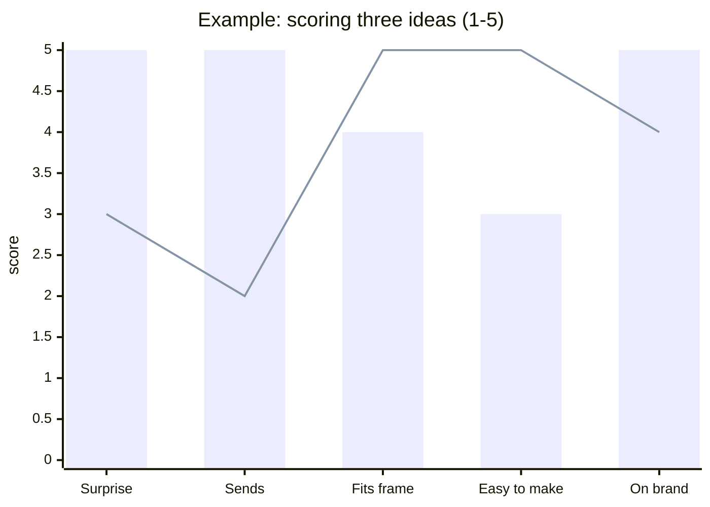

*Bars: a hidden-passenger scare. Line: a safer "object with a personality" gag. The top 3 by
total score are sketched for me.*

**What I get back:** the opportunity list with times, the top 3 ideas sketched on my real
frames, and 4–7 more ideas in one line each. Then I choose.

**Lore:** `D:\Claude\Video\lore.md` remembers recurring characters, like the wrist-hand, the
globe and the ghost. A later reel can bring one back half-hidden so fans start hunting for it,
and the same gag is never repeated the same way.

---

## 3. Story graphics: real-looking 3D in my real footage

### Example 1: "after I switch on the air fryer, the world gets slow" (Reel 29 v6)

<p align="center">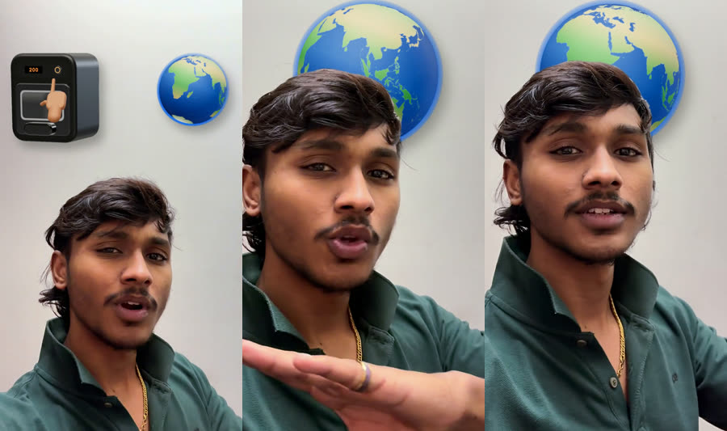</p>

A 3D air fryer drops in, and a little wrist-hand clicks its button. A globe spinning left to
right slows to a crawl. On "slow" the fryer is thrown away and the globe glides **behind my
head**, then whips off with a stretch.

### Example 2: the midnight ghost (Reel 29 v7)

<p align="center">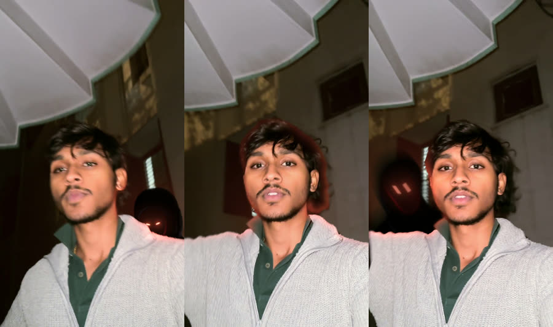</p>

A dark hooded ghost rises behind my **left** shoulder, only to shoulder level. Its red eyes
**light up my hair, ear and the wall** like real light. Then it swoops **behind my neck** on a
curve and out over my right shoulder. I never react to it.

### Every graphic goes through these steps, with my yes at each one

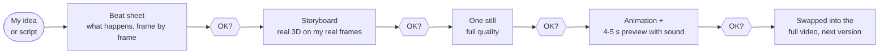

<p align="center">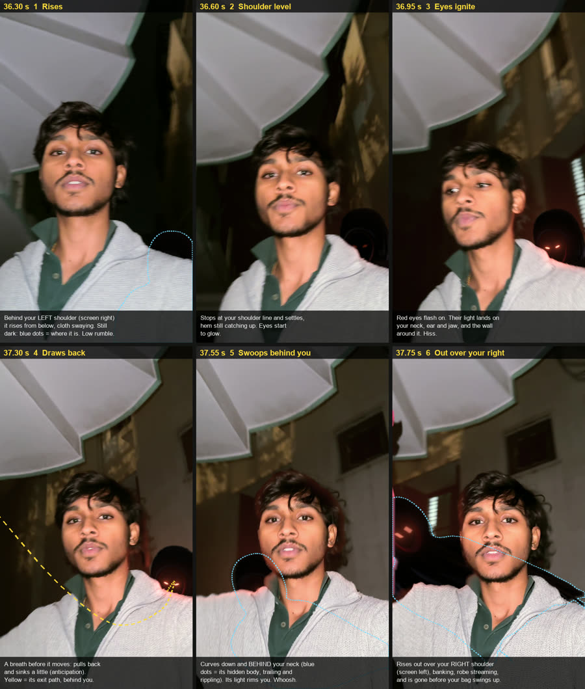</p>

*The approved ghost storyboard. Blue dots show the parts hidden behind me or in the dark, and
the yellow line is its exit path.*

### The 12 realism rules (every object, every frame)

| # | Rule | What it means |
|---|---|---|
| 1 | **Whole object, always** | Full body, even the parts hidden behind me. Never cut off in a straight line or faded out "because it's not seen" |
| 2 | **Depth** | I'm cut out on every frame (with hair strands), so things can go behind me |
| 3 | **Locked to the scene** | It sticks to me or to the room. Tracking is used only if it's accurate |
| 4 | **Lit by the room** | The same light direction and colour as my real scene |
| 5 | **Matched to the footage** | Same blacks, warmth, softness, blur by distance, camera grain, motion blur |
| 6 | **Shadows** | A soft shadow on the nearest surface |
| 7 | **Its light lights the world** | Glowing eyes or screens really light my face and the walls |
| 8 | **Moves like it's alive** | Bounce, wind-up, curves, trailing cloth, breathing. No sticker slides |
| 9 | **My body's sides** | "Left shoulder" means my left (the right of the screen) |
| 10 | **Soft sound, only for the graphic** | No glitches, sparkles, buzzers or risers |
| 11 | **Checked twice** | Frame by frame, before I see anything |
| 12 | **60 fps, no AI video, no paid services** | Everything is made on my own PC |

---

## What it uses

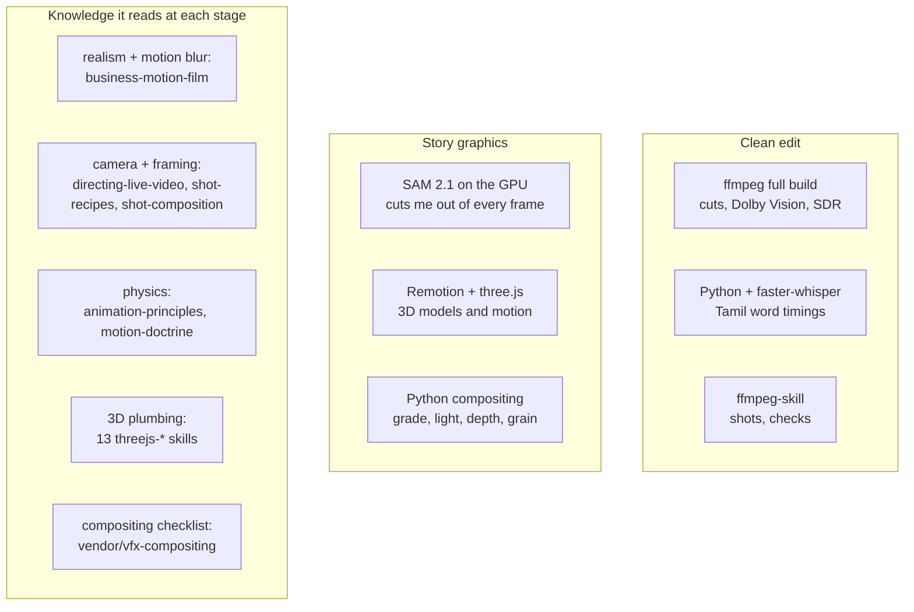

The full map of which skill is read at which stage is `gauthamwho-edit/reference/skill-routing.md`.
It also lists the skills that are **never** used: anything with paid APIs or AI video.

---

## Install

1. Copy these three folders into your Claude Code skills folder
   (`C:\Users\<you>\.claude\skills\` on Windows, `~/.claude/skills/` on Mac/Linux):
   `gauthamwho-edit`, `gauthamwho-ideas`, `gauthamwho-start`.
   ```bash
   git clone https://github.com/GauthamrajuG/gauthamwho-vlog-editing-skill
   ```
2. For story graphics, also copy the 13 `skills/threejs-*` folders from
   [CloudAI-X/threejs-skills](https://github.com/CloudAI-X/threejs-skills) (MIT).
3. Restart Claude Code and type `/gauthamwho`. All three commands appear.

On the first run, Claude checks what's missing and **asks before installing anything**.

| Needed | For | About |
|---|---|---|
| Git, Python 3.10+, Node.js | running the skill | 500 MB |
| ffmpeg **full build** (gyan.dev) + a Vulkan GPU | cutting, Dolby Vision, the SDR file | 170 MB |
| ffmpeg-skill, faster-whisper, OpenCV 4 | analysis, Tamil words, eye grids | 600 MB |
| NVIDIA GPU (4 GB+), PyTorch CUDA, SAM 2.1 | cutting me out (graphics only) | 3.5 GB |
| Remotion + three.js | 3D graphics only | 500 MB |

Built and tested on Windows 11, 7.5 GB RAM, GTX 1650. If a build crashes with "out of memory",
end the leaking Windows service **AppXSvc** in Task Manager (Details → the `svchost.exe` using
several GB → End task).

---

## What's inside

| Path | What it is |
|---|---|
| `gauthamwho-edit/SKILL.md` | the main skill: my editing style, both jobs, all the rules |
| `gauthamwho-edit/reference/creative-engine.md` | how ideas are found, filtered and presented |
| `gauthamwho-edit/reference/story-graphics.md` | the full graphics pipeline, with the air fryer and ghost as worked examples |
| `gauthamwho-edit/reference/skill-routing.md` | which skill to read at which stage, and the never-use list |
| `gauthamwho-edit/reference/pipeline.md` | exact commands, tools and PC fixes |
| `gauthamwho-edit/scripts/` | cut planner, eye grid, builder, transcriber, plus `graphics/` (cut-out, motion, compositing, sound) |
| `gauthamwho-edit/templates/` | the 3D models: air fryer, hand, globe, ghost (Remotion + three.js) |
| `gauthamwho-edit/vendor/` | three MIT guides: VFX compositing, shot direction, social shorts |
| `gauthamwho-ideas/`, `gauthamwho-start/` | the two short command files |
| `assets/` | the pictures in this README |

Credits: vendored guides from [calesthio/generative-media-skills](https://github.com/calesthio/generative-media-skills) (MIT).
The idea methods draw on Oblique Strategies, SCAMPER, benign violation theory (McGraw & Warren 2010),
jump-scare craft write-ups, and Instagram's published ranking signals.
